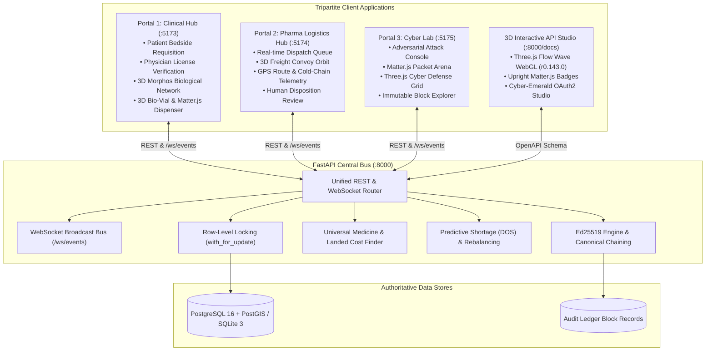

# PHARMASHIELD — SYSTEM ARCHITECTURE & INTEGRATION SPECIFICATION

**Hackathon:** Securathon 2026 (IIIT Bhagalpur) | **Track 2:** Cybersecurity (1.2x Multiplier)  
**Product Mission:** Intelligent, Predictive & Cryptographically Verifiable Medical Logistics  
**Tagline:** *"Every medical resource. Available when it matters."*  

---

## 1. ARCHITECTURAL OVERVIEW

PharmaShield is designed as a **Modular Monolith** pairing a high-throughput **FastAPI** backend with three specialized **Vite/React** portals, connected via native WebSocket event broadcasting and cryptographically chained through Ed25519 digital signatures and canonical SHA-256 event hashing.

---

## 2. THE THREE FRONTEND PORTALS & DESIGN INSPIRATIONS

### 2.1 Portal 1: Clinical Access Hub (`:5173`)
* **Design Reference:** Morphos (`scrollhaus.ai/sites/morphos/index.html`)
* **Palette:** `#010001` (near-black background), `#00D9FF` (cyan), `#247BFF` (medical blue), `#965BFF` (violet), `#F4F7FA` (soft white).
* **Capabilities:**
  1. **Patient Bedside Emergency View:** Bed `#ICU-04` trauma requisition (`Rohit Kumar`).
  2. **Doctor Verification:** `Dr. Ananya Sharma` reviews clinical notes and inputs Medical License `LIC-BH-8842-TRAUMA`.
  3. **Universal Medicine Availability Finder:** Multi-tier search (Local $\rightarrow$ District $\rightarrow$ Inter-State) with landed-cost transparency.
  4. **3D Morphos Biological Network:** 180+ glowing medical particles, neural/vascular connecting lines, and vital pulse dynamics.
  5. **3D Bio-Vial & Matter.js Dispenser:** Liquid shader changing color on live requisition status, dispensing physical capsules upon approval.

### 2.2 Portal 2: Pharma Operations & Logistics Network (`:5174`)
* **Design Reference:** FREIGHT / FORWARD (`scrollhaus.ai/sites/freight-forward/index.html`)
* **Palette:** `#141516` (charcoal), `#F7F5EF` (warm white), `#EE503B` (signal red), `#06B6D4` (cyan).
* **Capabilities:**
  1. **Vendor Dispatch Queue:** Incoming doctor-approved prescriptions awaiting vendor fulfillment.
  2. **1-Click Cryptographic Authorization:** Ed25519 digital signature signing and SHA-256 hash chaining.
  3. **3D Freight Logistics Scene:** 3D transport convoy vehicle traversing spline routes between Mayaganj Depot and JLNMCH Hospital.
  4. **Vector GPS Tracking:** Simulated live movement, custody waypoints, and 2.0°C–8.0°C cold-chain telemetry.
  5. **Human-in-the-Loop Cold-Chain Review:** Clinical disposition review modal for batches in `UNDER_REVIEW`.
  6. **Predictive Stockout Rebalancing:** 1-click dispatch to transfer surplus O+ RBC from Mayaganj / Sadar to JLNMCH.

### 2.3 Portal 3: Cyber Attack & Defense Lab (`:5175`)
* **Design Reference:** ZAPLINE (`scrollhaus.ai/sites/zapline/index.html`)
* **Palette:** `#050507` (black), `#F1F0E8` (warm ivory), `#D8FF77` (electric lime), `#A66CFF` (violet).
* **Capabilities:**
  1. **6-Vector Adversarial Exploit Console:** MITM quantity tampering, signature forgery, cold-chain excursion, telemetry spoofing, ABO mismatch, expired batch replay.
  2. **Matter.js Packet Arena:** Physics canvas representing incoming data packets, deflecting tampered packets to quarantine bins.
  3. **Three.js Cyber Grid:** Neon mesh reacting dynamically to security breach broadcasts.
  4. **Ledger Inspector:** Chronological explorer displaying SHA-256 hashes, Ed25519 signatures, and chain validation logs.

---

## 3. REAL-TIME SYNCHRONIZATION BUS

PharmaShield implements a native WebSocket event bus mounted at `/ws/events` and `/ws`.

### Event Lifecycle:
1. **`INITIAL_STATE`**: Emitted immediately upon socket connection. Provides full database snapshot of active requisitions, inventory, and facilities.
2. **`PRESCRIPTION_REQUESTED`**: Triggered when a patient submits a bedside requisition.
3. **`DOCTOR_PRESCRIPTION_APPROVED`**: Triggered when a physician signs a requisition with their medical license.
4. **`REQUISITION_AUTHORIZED`**: Triggered when a depot dispatches inventory using an Ed25519 signature. Deducts stock via database row-level locking.
5. **`COLD_CHAIN_DISPOSITION_RECORDED`**: Triggered when an authorized inspector records a qualified review for a quarantined shipment.
6. **`SECURITY_ALERT`**: Broadcast across all portals if cryptographic verification fails or a safety constraint is breached.

---

## 4. ZERO-TRUST CRYPTOGRAPHIC LEDGER

PharmaShield rejects fake blockchain gas fees and deployment complexity by utilizing Python's native `cryptography.hazmat.primitives.asymmetric.ed25519` library:

$$\text{Canonical Payload} = \text{Deterministic JSON (Sorted Keys, No Whitespace)}$$
$$H_i = \text{SHA-256}(H_{i-1} \parallel \text{CanonicalBytes}(\text{Payload}_i))$$
$$\text{Signature}_i = \text{Ed25519Sign}(\text{PrivateKey}_{\text{Authority}}, H_i)$$

Tampering with any single parameter (e.g. quantity from 10 to 500) results in an instant SHA-256 hash avalanche, failing signature verification and deflecting the payload to quarantine.
