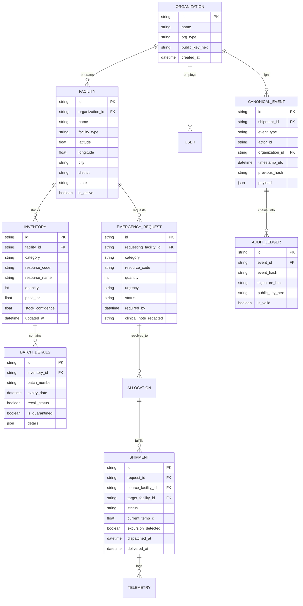

# PharmaShield — Database Schema & Data Architecture Specification

> **Hackathon:** Securathon 2026 (IIIT Bhagalpur) — Track 2: Cybersecurity (1.2x Multiplier)  
> **Platform:** Intelligent, Predictive & Cryptographically Verifiable Medical Logistics  
> **Engines Supported:** PostgreSQL 16 + PostGIS (Production) | SQLite 3 (Zero-Config Embedded)  
> **ORM Layer:** SQLAlchemy 2.0 Declarative with Strict Pydantic v2 Type Parity

---

## 1. Entity-Relationship Overview

PharmaShield unifies hospital requisitions, multi-tier pharmaceutical inventory, cold-chain telemetry, and cryptographic audit records into a cohesive relational graph:



---

## 2. Relational Table Specifications

### 2.1 Organizations & Facilities

#### `organizations`
Stores institutional entities (hospital trusts, government health departments, pharmaceutical logistics providers) authorized to sign events on the cryptographic ledger.

| Column | Type | Constraints | Description |
|---|---|---|---|
| `id` | `VARCHAR(64)` | `PRIMARY KEY` | Deterministic slug (e.g. `org_jlnmch`, `org_mayaganj`) |
| `name` | `VARCHAR(255)` | `NOT NULL` | Registered institutional name |
| `org_type` | `VARCHAR(64)` | `NOT NULL` | `HOSPITAL`, `GOVERNMENT`, `LOGISTICS`, `PHARMACY` |
| `public_key_hex` | `VARCHAR(64)` | `NOT NULL, UNIQUE` | Registered Ed25519 32-byte public key (64 hex characters) |
| `created_at` | `TIMESTAMP` | `DEFAULT UTC_NOW` | Organization enrollment timestamp |

#### `facilities`
Physical healthcare centers, blood banks, laboratories, and warehouses equipped with GPS coordinates for spatial routing.

| Column | Type | Constraints | Description |
|---|---|---|---|
| `id` | `VARCHAR(64)` | `PRIMARY KEY` | Facility identifier (e.g. `fac_jlnmch_main`) |
| `organization_id` | `VARCHAR(64)` | `FOREIGN KEY (organizations.id)` | Owning organization |
| `name` | `VARCHAR(255)` | `NOT NULL` | Facility name |
| `facility_type` | `VARCHAR(64)` | `NOT NULL` | `HOSPITAL`, `BLOOD_BANK`, `WAREHOUSE`, `CLINIC` |
| `latitude` | `FLOAT` | `NOT NULL` | Decimal latitude (-90.0 to +90.0) |
| `longitude` | `FLOAT` | `NOT NULL` | Decimal longitude (-180.0 to +180.0) |
| `city` | `VARCHAR(128)` | `NOT NULL, DEFAULT 'Bhagalpur'` | City (Bhagalpur, Siliguri, Kolkata, Patna, Ranchi) |
| `district` | `VARCHAR(128)` | `NOT NULL, DEFAULT 'Bhagalpur'` | Administrative district |
| `state` | `VARCHAR(128)` | `NOT NULL, DEFAULT 'Bihar'` | Indian State (Bihar, West Bengal, Jharkhand) |
| `is_active` | `BOOLEAN` | `NOT NULL, DEFAULT TRUE` | Active facility status |

---

### 2.2 Multi-Tier Inventory & Batch Management

#### `inventory`
Real-time stock aggregates maintained at each healthcare facility across 6 categories.

| Column | Type | Constraints | Description |
|---|---|---|---|
| `id` | `VARCHAR(64)` | `PRIMARY KEY` | Unique stock bucket identifier |
| `facility_id` | `VARCHAR(64)` | `FOREIGN KEY (facilities.id)` | Stock storage facility |
| `category` | `VARCHAR(64)` | `NOT NULL` | Enum: `MEDICINES`, `BLOOD_COMPONENTS`, `MEDICAL_EQUIPMENT`, `VACCINES`, `DIAGNOSTIC_SAMPLES`, `EMERGENCY_SUPPLIES` |
| `resource_code` | `VARCHAR(128)` | `NOT NULL` | Standardized resource code (e.g. `O_POS_RBC`, `INSULIN_GLARGINE`, `TRAUMA_KIT`) |
| `resource_name` | `VARCHAR(255)` | `NOT NULL` | Descriptive commercial / generic name |
| `quantity` | `INTEGER` | `NOT NULL, CHECK (quantity >= 0)` | Currently available physical units |
| `price_inr` | `FLOAT` | `NOT NULL, DEFAULT 0.0` | Base wholesale price per unit in Indian Rupees |
| `stock_confidence`| `FLOAT` | `NOT NULL, DEFAULT 1.0` | IoT / RFID confidence factor (0.0 to 1.0) |
| `updated_at` | `TIMESTAMP` | `DEFAULT UTC_NOW` | Last inventory adjustment timestamp |

#### `batches`
Granular batch tracking enforcing pharmaceutical compliance, cold-chain bounds, and expiry enforcement.

| Column | Type | Constraints | Description |
|---|---|---|---|
| `id` | `VARCHAR(64)` | `PRIMARY KEY` | Batch ID (e.g. `BATCH-MED-INS-01`) |
| `inventory_id` | `VARCHAR(64)` | `FOREIGN KEY (inventory.id)` | Parent inventory record |
| `batch_number` | `VARCHAR(128)` | `NOT NULL` | Manufacturer lot/batch stamp |
| `expiry_date` | `TIMESTAMP` | `NOT NULL` | Batch expiration boundary |
| `recall_status` | `BOOLEAN` | `NOT NULL, DEFAULT FALSE` | Regulatory recall lock flag |
| `is_quarantined` | `BOOLEAN` | `NOT NULL, DEFAULT FALSE` | Facility quarantine lock flag |
| `details` | `JSON` | `NULLABLE` | Category-specific attributes (blood ABO/Rh, cold-chain bounds, calibration dates) |

---

### 2.3 Emergency Logistics & Custody Transfer

#### `emergency_requests`
Life-critical requisitions issued by clinicians requiring algorithmic matching and human-in-the-loop authorization.

| Column | Type | Constraints | Description |
|---|---|---|---|
| `id` | `VARCHAR(64)` | `PRIMARY KEY` | Request ID (e.g. `REQ-2026-001`) |
| `requesting_facility_id` | `VARCHAR(64)` | `FOREIGN KEY (facilities.id)` | Requisitioning hospital |
| `category` | `VARCHAR(64)` | `NOT NULL` | Resource category |
| `resource_code` | `VARCHAR(128)` | `NOT NULL` | Standardized SKU / resource type |
| `quantity` | `INTEGER` | `NOT NULL, CHECK (quantity > 0)` | Requisitioned units |
| `urgency` | `VARCHAR(32)` | `NOT NULL` | `LOW`, `STANDARD`, `URGENT`, `CRITICAL` |
| `status` | `VARCHAR(32)` | `NOT NULL, DEFAULT 'PENDING'` | `PENDING`, `ALLOCATED`, `AUTHORIZED`, `DISPATCHED`, `DELIVERED`, `CANCELLED` |
| `required_by` | `TIMESTAMP` | `NOT NULL` | Maximum clinical arrival deadline |
| `clinical_note_redacted`| `TEXT` | `NULLABLE` | Anonymized clinical justification (HIPAA/DISHA compliant) |
| `created_at` | `TIMESTAMP` | `DEFAULT UTC_NOW` | Submission timestamp |

#### `shipments`
Active transport conduits tracking physical consignments, custody transfers, and live telemetry.

| Column | Type | Constraints | Description |
|---|---|---|---|
| `id` | `VARCHAR(64)` | `PRIMARY KEY` | Shipment consignment ID (e.g. `SHP-2026-001`) |
| `request_id` | `VARCHAR(64)` | `FOREIGN KEY (emergency_requests.id)` | Associated requisition |
| `source_facility_id` | `VARCHAR(64)` | `FOREIGN KEY (facilities.id)` | Dispatching supplier facility |
| `target_facility_id` | `VARCHAR(64)` | `FOREIGN KEY (facilities.id)` | Destination clinical facility |
| `status` | `VARCHAR(32)` | `NOT NULL, DEFAULT 'PENDING'` | `PENDING`, `DISPATCHED`, `IN_TRANSIT`, `UNDER_REVIEW`, `DELIVERED`, `REJECTED` |
| `current_temp_c` | `FLOAT` | `NULLABLE` | Latest sensor temperature reading |
| `excursion_detected` | `BOOLEAN` | `NOT NULL, DEFAULT FALSE` | Flag raised if reading breached 2.0°C–8.0°C |
| `dispatched_at` | `TIMESTAMP` | `NULLABLE` | Physical dispatch departure timestamp |
| `delivered_at` | `TIMESTAMP` | `NULLABLE` | Verified custody receipt timestamp |

#### `telemetry_logs`
High-frequency sensor stream recording cold-chain telemetry during active transit.

| Column | Type | Constraints | Description |
|---|---|---|---|
| `id` | `INTEGER` | `PRIMARY KEY, AUTOINCREMENT` | Monotonic log sequence |
| `shipment_id` | `VARCHAR(64)` | `FOREIGN KEY (shipments.id)` | Monitored shipment |
| `temperature_c` | `FLOAT` | `NOT NULL` | Ambient cryo-box temperature reading |
| `latitude` | `FLOAT` | `NOT NULL` | GPS latitude coordinate |
| `longitude` | `FLOAT` | `NOT NULL` | GPS longitude coordinate |
| `battery_pct` | `FLOAT` | `NOT NULL, DEFAULT 100.0` | IoT sensor battery percentage |
| `timestamp` | `TIMESTAMP` | `DEFAULT UTC_NOW` | Sensor record timestamp |

---

### 2.4 Cryptographic Audit Ledger & Chain of Custody

#### `canonical_events`
Deterministic ledger events serialized using canonical JSON format (sorted keys, no whitespace separators) to guarantee identical hash calculation across nodes.

| Column | Type | Constraints | Description |
|---|---|---|---|
| `id` | `VARCHAR(64)` | `PRIMARY KEY` | Event ID (e.g. `evt_genesis_000`, `evt_req_001`) |
| `shipment_id` | `VARCHAR(64)` | `NULLABLE` | Correlated shipment (or `None` for genesis/rebalance) |
| `event_type` | `VARCHAR(64)` | `NOT NULL` | `GENESIS`, `REQUISITION_CREATED`, `ORDER_AUTHORIZED`, `DISPATCHED`, `CUSTODY_TRANSFERRED`, `SENSOR_EXCURSION`, `DELIVERED` |
| `actor_id` | `VARCHAR(128)` | `NOT NULL` | Identifier of the clinical actor or automated system |
| `organization_id` | `VARCHAR(64)` | `FOREIGN KEY (organizations.id)` | Signing institutional authority |
| `timestamp_utc` | `VARCHAR(64)` | `NOT NULL` | Strict ISO-8601 UTC timestamp string |
| `previous_hash` | `VARCHAR(64)` | `NOT NULL` | 64-character hex SHA-256 hash of previous block |
| `payload` | `JSON` | `NOT NULL` | Canonical operational payload |

#### `audit_ledger_records`
Cryptographic signature envelope verifying the authenticity of each canonical event.

| Column | Type | Constraints | Description |
|---|---|---|---|
| `id` | `VARCHAR(64)` | `PRIMARY KEY` | Audit record identifier |
| `event_id` | `VARCHAR(64)` | `FOREIGN KEY (canonical_events.id)` | Linked canonical event |
| `event_hash` | `VARCHAR(64)` | `NOT NULL, UNIQUE` | $H_i = \text{SHA-256}(H_{i-1} \parallel \text{CanonicalPayload}_i)$ |
| `signature_hex` | `TEXT` | `NOT NULL` | Ed25519 64-byte signature encoded in hex (128 hex chars) |
| `public_key_hex` | `VARCHAR(64)` | `NOT NULL` | 32-byte Ed25519 public key in hex format |
| `is_valid` | `BOOLEAN` | `NOT NULL, DEFAULT TRUE` | Instant verification check status |

---

## 3. Concurrency & Row-Level Locking Specification

In emergency medical distribution, race conditions must be prevented. If two hospitals simultaneously request the remaining 4 units of O+ blood, standard database isolation would allow both to read `quantity = 4`, leading to dangerous over-allocation.

PharmaShield implements **Pessimistic Row-Level Locking**:

```python
# backend/app/api/v1/requests.py / routes.py
# Inside database transaction:
inv = db.query(Inventory).filter(
    Inventory.facility_id == source_facility_id,
    Inventory.resource_code == req.resource_code
).with_for_update().first()

if not inv or inv.quantity < req.quantity:
    raise HTTPException(status_code=400, detail="Insufficient stock units available")

# Atomically decrement within the locked row boundary
inv.quantity -= req.quantity
db.commit()
```

- **PostgreSQL**: Emits `SELECT ... FOR UPDATE`, locking the physical database row until `db.commit()` or `db.rollback()` executes.
- **SQLite**: Enforces database-level write serializability (`IMMEDIATE` transaction) preventing concurrent race conditions.

---

## 4. PostGIS Geospatial Support

When deployed on PostgreSQL with the PostGIS extension enabled (`postgis/postgis:16-3.4`), the database maintains spatial indexes for instant distance queries:

```sql
-- Spatial distance query in PostgreSQL with PostGIS
SELECT 
    f.id, 
    f.name, 
    ST_Distance(
        ST_SetSRID(ST_MakePoint(f.longitude, f.latitude), 4326)::geography,
        ST_SetSRID(ST_MakePoint(87.0125, 25.2445), 4326)::geography
    ) / 1000.0 AS distance_km
FROM facilities f
WHERE f.is_active = TRUE
ORDER BY distance_km ASC;
```

In embedded SQLite mode, the platform utilizes the Haversine trigonometric formula implemented natively in Python (`backend/app/services/matching.py`), guaranteeing zero-dependency fallback without performance degradation.
