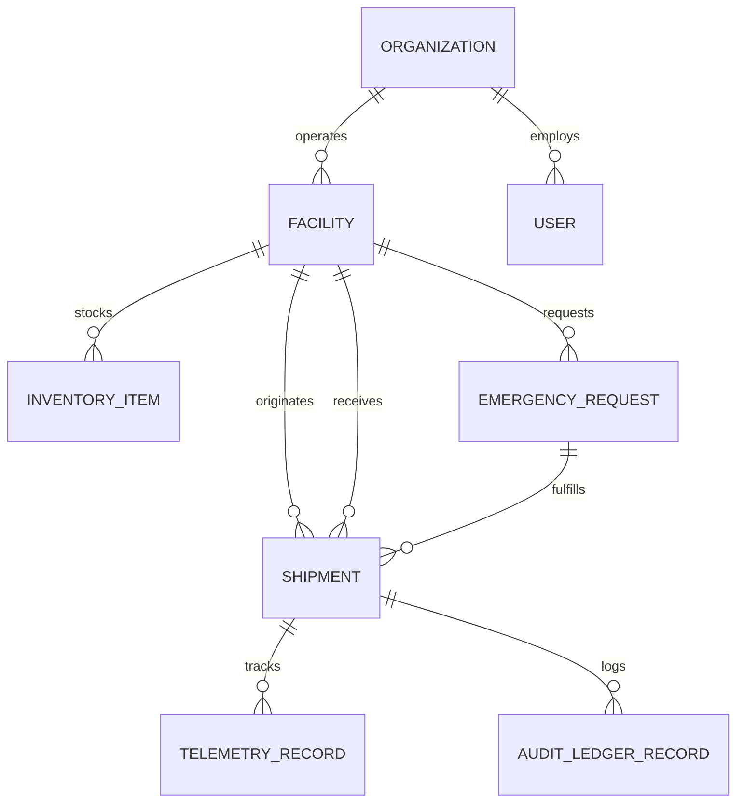
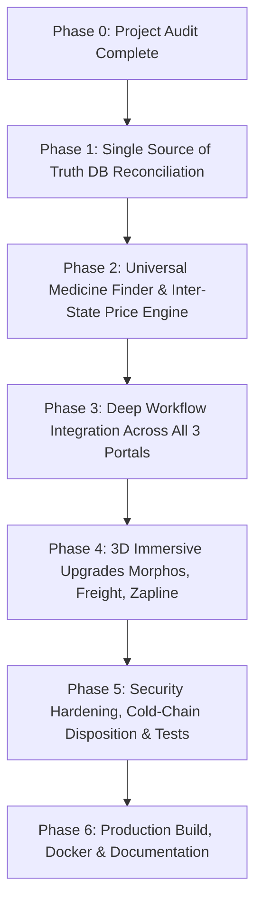

# PHARMASHIELD — COMPREHENSIVE PROJECT AUDIT & INTEGRATION BLUEPRINT
**Hackathon:** Securathon 2026 (IIIT Bhagalpur) | **Track 2:** Cybersecurity (1.2x Multiplier)  
**Product Mission:** Intelligent, Predictive & Cryptographically Verifiable Medical Logistics  
**Tagline:** *"Every medical resource. Available when it matters."*  
**Date of Audit:** November 1, 2026  
**Auditor:** Principal Software Architect & Full-Stack Systems Engineer  

---

## 1. EXECUTIVE SUMMARY & MONOREPO TOPOLOGY

PharmaShield is designed as a **modular monolith** consisting of a centralized FastAPI backend and three dedicated frontends running on Vite/React. Additionally, an earlier consolidated frontend (`frontend/`) contains production-ready domain widgets (Leaflet GIS mapping, Recharts cold-chain monitors, and multi-step matching wizards) that are being harvested into the unified ecosystem.

```
pharma-shield/
├── backend/                       # Shared FastAPI backend (:8000), ORM, Crypto & Real-Time Bus
│   ├── app/
│   │   ├── api/
│   │   │   ├── routes.py          # Unified tripartite REST & /ws/events WebSocket bus
│   │   │   └── v1/                # Modular domain routers (auth, inventory, requests, etc.)
│   │   ├── core/                  # Database, Config, Security, Custom 3D Docs UI
│   │   ├── models/                # SQLAlchemy 2.0 ORM models (SQLite / PostgreSQL)
│   │   ├── schemas/               # Pydantic v2 data contracts
│   │   └── services/              # Pure domain logic (Crypto, Matching, Forecasting, Cold-Chain)
│   ├── scripts/                   # Seed data (Bhagalpur centers) & Ed25519 key generators
│   └── main.py                    # Entrypoint with CORS, WebSockets, and 3D Flow Wave /docs
├── portal-doctor-patient/         # Frontend 1: Clinical Hub (:5173) [Morphos Reference]
│   └── src/components/            # PatientView, EmergencyOrderForm, ThreeBioVial, MatterSupplyDrop
├── portal-pharma-ops/             # Frontend 2: Logistics & Depot Hub (:5174) [Freight Reference]
│   └── src/components/            # ActiveOrderShowcase, RequisitionTable, StockAllocation, VendorLogin
├── portal-cyber-lab/              # Frontend 3: Cyber Attack & Defense Lab (:5175) [Zapline Reference]
│   └── src/components/            # AttackConsole, LedgerInspector, MatterPacketArena, ThreeCyberGrid
├── frontend/                      # Legacy/Consolidated UI (CommandMap, ColdChainChart, SecurityLab)
├── simulators/                    # IoT sensor simulator & CLI attack demo scripts
├── pharmashield.db                # Active SQLite 3 database (fallback for PostgreSQL/PostGIS)
├── run_all.bat & run_all.ps1      # Tripartite orchestrators launching all 4 servers concurrently
└── docker-compose.yml             # PostgreSQL 16 + PostGIS production configuration
```

---

## 2. DETAILED AUDIT OF THE FOUR APPLICATIONS

### 2.1 Frontend 1: Clinical Access Hub (`portal-doctor-patient`)
* **Local Address:** `http://localhost:5173`
* **Framework:** React 18.3, TypeScript, Vite 5.4, TailwindCSS 3.4
* **Target Design Evolution:** Inspired by **Morphos** (`scrollhaus.ai/sites/morphos/index.html`) — near-black background (`#010001`), medical blue (`#247BFF`), cyan (`#00D9FF`), and biological particle networks.
* **Current Purpose & Capabilities:**
  1. **Dual-Role Switching:** Allows switching between **Patient** (`Rohit Kumar`, Bed `#ICU-04`, `PT-2026-JLNMCH-04`) and **Doctor** (`Dr. Ananya Sharma`, Chief of Trauma & Critical Care).
  2. **Bedside Emergency Requisition:** Patient submits bedside emergency requests (e.g. `O_POS_RBC`, `INSULIN_GLARGINE`) with clinical symptom notes.
  3. **Physician License Verification:** Doctor reviews incoming emergency requests, validates urgency, inputs license ID (`LIC-BH-8842-TRAUMA`), and signs off on the prescription.
  4. **Interactive 3D Bio-Vial:** Renders a Three.js WebGL cylinder with custom glass shaders and dynamic fluid levels reflecting the active resource.
  5. **Matter.js Supply Dispenser:** 2D rigid-body physics arena dispensing physical medicine capsules upon order authorization.
  6. **Zero-Trust Security Banner:** Displays real-time sticky banners if an order is intercepted or quarantined.

### 2.2 Frontend 2: Pharma Operations & Logistics Network (`portal-pharma-ops`)
* **Local Address:** `http://localhost:5174`
* **Framework:** React 18.3, TypeScript, Vite 5.4, TailwindCSS 3.4
* **Target Design Evolution:** Inspired by **FREIGHT / FORWARD** (`scrollhaus.ai/sites/freight-forward/index.html`) — charcoal (`#141516`), warm white (`#F7F5EF`), and signal red (`#EE503B`) cinematic logistics.
* **Current Purpose & Capabilities:**
  1. **Central Depot Authentication:** Vendor login modal for Bhagalpur medical facilities (Mayaganj Central Depot, JLNMCH, Sadar Hospital).
  2. **Active Order Showcase:** Real-time incoming queue displaying doctor-approved prescriptions awaiting vendor fulfillment.
  3. **Cryptographic 1-Click Authorization:** Dispatches supplies using Ed25519 digital signatures, calculating the SHA-256 hash and chaining into the audit ledger.
  4. **Dynamic Inventory Deduction:** Immediately decrements inventory counts and recalculates **Days of Stock (DOS)** using `units / daily_consumption`.
  5. **Visual Cold-Chain Indicators:** Displays real-time temperature status and alerts if an item exceeds safe boundaries (2.0°C – 8.0°C).

### 2.3 Frontend 3: Cyber Attack & Defense Lab (`portal-cyber-lab`)
* **Local Address:** `http://localhost:5175`
* **Framework:** React 18.3, TypeScript, Vite 5.4, TailwindCSS 3.4
* **Target Design Evolution:** Inspired by **ZAPLINE** (`scrollhaus.ai/sites/zapline/index.html`) — deep black (`#050507`), warm ivory (`#F1F0E8`), and electric lime (`#D8FF77`) command center.
* **Current Purpose & Capabilities:**
  1. **Adversarial Exploit Console:** Enables operators to simulate 6 live attack vectors:
     - *Man-in-the-Middle (MITM) Quantity Tampering:* Inflates requisition quantities to detect SHA-256 hash divergence and Ed25519 signature failure.
     - *Signature Forgery:* Injects fake signature bytes to verify zero-trust rejection.
     - *Thermal Excursion:* Injects out-of-band temperature breaches (e.g. 14.8°C) to lock batches into `UNDER_REVIEW`.
     - *Telemetry Spoofing:* Spoofs GPS and temperature records to verify anomaly filters.
     - *ABO Blood Incompatibility:* Attempts to allocate B+ blood to an O+ patient, triggering hard clinical rejection.
     - *Replay Expired Batch:* Attempts to reinject decommissioned/expired medicine batches.
  2. **Matter.js Packet Arena:** Physics canvas representing incoming network packets; malicious payloads are deflected into quarantine bins.
  3. **Three.js Cyber Grid:** Neon background mesh that pulses emerald when clean and transitions into intense flashing crimson during attack deflection.
  4. **Cryptographic Ledger Inspector:** Chronological block explorer displaying event hashes, Ed25519 signatures, previous hashes, and chain integrity status.

### 2.4 Central Backend & 3D Interactive Studio (`backend`)
* **Local Address:** `http://localhost:8000` (API Docs at `/docs`)
* **Framework:** FastAPI 0.110+, Uvicorn, SQLAlchemy 2.0, Pydantic v2, Cryptography 42.0+
* **Docs UI:** Custom **Flow Wave Three.js WebGL** scene (`r0.143.0`) with Simplex noise shaders, 3-stage `EffectComposer` postprocessing (bloom, torus, final), and an upright **Matter.js** rigid-body floating badge arena.
* **Event Bus:** WebSocket broadcaster mounted at `/ws/events` transmitting real-time state changes to all connected portals simultaneously.

---

## 3. BACKEND ROUTE & ENDPOINT INVENTORY

| Method | Endpoint | Source File | Purpose | Auth / Security |
|---|---|---|---|---|
| `GET` | `/health`, `/api/v1/health` | `backend/main.py` | Health check & SQLite/PostgreSQL connection verify | Public |
| `GET` | `/docs` | `backend/main.py` | 3D Three.js & Matter.js custom API Documentation | Public |
| `WS` | `/ws/events` | `backend/app/api/routes.py` | Real-time WebSocket broadcasting bus for all portals | Public (Token Optional) |
| `GET` | `/api/v1/requisitions` | `backend/app/api/routes.py` | List all medical requisitions sorted chronologically | Read-only |
| `POST` | `/api/v1/patient/prescription` | `backend/app/api/routes.py` | Patient submits bedside emergency prescription | Role: PATIENT |
| `POST` | `/api/v1/doctor/prescriptions/{id}/approve` | `backend/app/api/routes.py` | Doctor approves & signs prescription with license ID | Role: DOCTOR |
| `POST` | `/api/v1/requisitions` | `backend/app/api/routes.py` | Direct creation of hospital emergency requisition | Role: CLINICIAN |
| `POST` | `/api/v1/requisitions/{id}/authorize` | `backend/app/api/routes.py` | Depot authorizes shipment via Ed25519 signature & hash chain | Role: DISPATCHER / VENDOR |
| `POST` | `/api/v1/attack` | `backend/app/api/routes.py` | Triggers adversarial attack simulation & verification | Role: CYBER_LAB |
| `GET` | `/api/v1/inventory` | `backend/app/api/routes.py` | Get stock counts across all Bhagalpur depots | Read-only |
| `GET` | `/api/v1/ledger` | `backend/app/api/routes.py` | Inspect immutable Ed25519/SHA-256 audit ledger | Read-only |
| `POST` | `/api/v1/auth/token` | `backend/app/api/v1/auth.py` | OAuth2 password bearer token issue (Argon2id) | Public |
| `GET` | `/api/v1/auth/me` | `backend/app/api/v1/auth.py` | Current authenticated user profile | Bearer JWT |
| `GET` | `/api/v1/inventory/query` | `backend/app/api/v1/inventory.py` | 6-category database stock query with filters | Bearer JWT |
| `POST` | `/api/v1/inventory/quarantine` | `backend/app/api/v1/inventory.py` | Quarantine batch across facilities | Role: ADMIN / CLINICIAN |
| `POST` | `/api/v1/requests/` | `backend/app/api/v1/requests.py` | Create emergency request in DB | Bearer JWT |
| `GET` | `/api/v1/requests/matches/{id}` | `backend/app/api/v1/requests.py` | 5-factor AI matching scores for emergency request | Bearer JWT |
| `POST` | `/api/v1/shipments/` | `backend/app/api/v1/shipments.py` | Create shipment in DB | Bearer JWT |
| `POST` | `/api/v1/shipments/{id}/telemetry` | `backend/app/api/v1/shipments.py` | Ingest IoT temperature & GPS coordinates | Device / Bearer JWT |
| `GET` | `/api/v1/ai/matching` | `backend/app/api/v1/ai.py` | Direct AI scoring query for resource & location | Bearer JWT |
| `GET` | `/api/v1/ai/shortage-forecast` | `backend/app/api/v1/ai.py` | Days of Stock (DOS) prediction & alert evaluation | Bearer JWT |
| `POST` | `/api/v1/security/verify` | `backend/app/api/v1/security.py` | Cryptographically verify Ed25519 event signature | Public / Verified |
| `GET` | `/api/v1/security/ledger` | `backend/app/api/v1/security.py` | Get DB audit ledger records | Bearer JWT |

---

## 4. DATABASE MODELS & SCHEMA AUDIT

The persistent database is verified in `pharmashield.db` (SQLite 3), structured to migrate seamlessly to PostgreSQL 16 + PostGIS via SQLAlchemy 2.0 Declarative Models:



### Table Specifications:
1. **`organizations`** (`id`, `name`, `org_type`, `public_key_hex`, `created_at`): 4 seeded organizations (JLNMCH Network, Mayaganj Depot Council, Sadar District Health, IIIT Health).
2. **`facilities`** (`id`, `name`, `organization_id`, `type`, `lat`, `lng`, `contact`, `is_verified`, `city`, `reliability_score`): 4 verified Bhagalpur medical facilities with real geographic coordinates.
3. **`users`** (`id`, `email`, `full_name`, `hashed_password`, `organization_id`, `facility_id`, `role`, `is_active`): Role-based access control.
4. **`inventory_items`** (`id`, `facility_id`, `category`, `resource_code`, `name`, `batch_number`, `units_available`, `expiry_date`, `status`, `min_temp`, `max_temp`, `details`, `daily_consumption`): 15 seeded items covering all 6 medical categories.
5. **`emergency_requests`** (`id`, `requesting_facility_id`, `category`, `resource_code`, `quantity`, `urgency`, `status`, `required_by`, `clinical_note_redacted`): Medical requests tracking requisition status.
6. **`shipments`** (`id`, `request_id`, `sender_id`, `recipient_id`, `status`, `driver_name`, `current_temp`, `min_temp`, `max_temp`, `requires_cold_chain`, `latest_lat`, `latest_lng`): Cold-chain and transport tracking.
7. **`telemetry_records`** (`id`, `shipment_id`, `temperature_c`, `humidity_percent`, `latitude`, `longitude`, `timestamp_utc`, `is_excursion`, `battery_level`): Sensor time-series records.
8. **`audit_ledger_records`** (`id`, `shipment_id`, `event_type`, `actor_id`, `organization_id`, `timestamp_utc`, `previous_hash`, `payload`, `event_hash`, `signature_hex`, `public_key_hex`, `is_valid`): Tamper-evident cryptographic ledger.

---

## 5. RECONCILIATION OF THE 6 CORE HEALTHCARE PROBLEMS

| Core Problem | Current Status | Implemented Components | Missing / Needed Enhancements |
|---|---|---|---|
| **1. Hospital Blood Stockouts** | Partially Implemented | Hard ABO compatibility filter (`matching.py`), O+ RBC crisis seed (`DOS=0.8d` at JLNMCH), emergency requisition flow. | Cross-facility automated rebalancing suggestions, real-time donor bank inventory pooling without public trading. |
| **2. Vaccine Cold-Chain Spoilage** | Substantially Implemented | Strict 2.0°C–8.0°C threshold validator, excursion lock to `UNDER_REVIEW`, `Recharts` temperature graph in `frontend/`, attack console excursion trigger. | Human-in-the-loop qualified inspector review interface to record final disposition (reject vs cleared with override). |
| **3. Medicine Unavailable Locally** | Conceptually Present | Stock query endpoint and basic distance calculation. | **Universal Medicine Availability Finder** searching local -> district -> inter-state pharmacies with landed cost comparison. |
| **4. Inter-State Price Intelligence** | Seed Data Only | Inventory records have pricing details in JSON. | State-wise price comparison dashboard, landed-cost formula (`price + shipping + charges`), stale-price warnings, anomaly detection. |
| **5. Medical Shipment Visibility** | Partially Implemented | Leaflet `CommandMap` in `frontend/`, `shipments` table, telemetry ingestion. | Unified live map in Portal 2 showing active courier route, simulated GPS movement, ETA calculation, and breadcrumb trails. |
| **6. Predictive Shortage Prevention** | Mathematically Implemented | `forecasting.py` (`DOS = units / daily_consumption`), alerts triggered when `DOS <= lead_time`. | Automated scheduled background evaluation that pushes real-time WebSocket alerts to all portals before stock exhausts. |

---

## 6. EXISTING BUGS, ARCHITECTURAL GAPS & RISKS

1. **Dual State Disconnect (In-Memory vs Database):**
   * *Problem:* `backend/app/api/routes.py` maintains fast in-memory dictionaries (`REQUISITIONS`, `INVENTORY`) for WebSocket broadcasting, while `backend/app/api/v1/*.py` queries the SQLAlchemy database.
   * *Solution:* Unify `routes.py` to persist all writes directly to SQLite/PostgreSQL while continuing to broadcast real-time state via `event_bus`.
2. **Missing Inter-Portal Navigation Bar:**
   * *Problem:* Users navigating between ports 5173, 5174, and 5175 currently have no shared header to seamlessly jump between Clinical, Logistics, and Cyber Lab.
   * *Solution:* Implement a sleek, shared **PharmaShield Tripartite Command Strip** across all three portals showing live connection status and 1-click cross-portal navigation.
3. **Price Intelligence Engine Missing:**
   * *Problem:* Currently, medicine searching is facility-centric rather than medicine-centric.
   * *Solution:* Implement `/api/v1/medicines/search` and `/api/v1/prices/compare` calculating `Landed Cost = Listed Price + Shipping + Applicable Charges` across Indian states (Bihar, West Bengal, Jharkhand, Delhi NCR).
4. **Qualified Cold-Chain Disposition:**
   * *Problem:* When a shipment enters `UNDER_REVIEW` following an excursion, there is no UI action for a qualified pharmacist to review the sensor log and record a disposition.
   * *Solution:* Add an authorized "Clinical Disposition Review" modal in Portal 2 with cryptographic sign-off.

---

## 7. FEATURES THAT MUST NOT BE REWRITTEN (STRICT PRESERVATION)

1. **Flow Wave Three.js WebGL & Matter.js Documentation at `/docs`**:
   * The shaders, Simplex noise wave, 3-stage `EffectComposer` pipeline, upright Matter.js physics badges, and cyber-emerald OAuth2 modal must remain untouched.
2. **Ed25519 Cryptographic Signatures & SHA-256 Chaining**:
   * The pure Python cryptography implementation (`backend/app/services/crypto.py` and `crypto_ledger.py`) using `cryptography.hazmat.primitives.asymmetric.ed25519` and canonical JSON byte serialization must be preserved 1:1.
3. **ABO Blood Compatibility Matrix**:
   * The medical rules in `matching.py` mapping donors to compatible recipients (e.g. O- universal donor, O+ limited to positive recipients) must never be bypassed.
4. **3D Bio-Vial & Matter Supply Dispenser in Portal 1**:
   * The WebGL Three.js cylinder and Matter.js capsule drop simulation must remain functioning in the clinical portal.
5. **Real-Time WebSocket Bus (`/ws/events`)**:
   * The native FastAPI WebSocket connection manager and JSON event format (`INITIAL_STATE`, `PRESCRIPTION_REQUESTED`, `DOCTOR_PRESCRIPTION_APPROVED`, `REQUISITION_AUTHORIZED`, `SECURITY_ALERT`) must remain the core real-time backbone.
6. **Bhagalpur Healthcare Facilities Seed Data**:
   * The verified coordinates, facility roles, and critical stock levels for JLNMCH, Mayaganj Depot, Sadar Hospital, and IIIT Bhagalpur Health Clinic must be maintained.

---

## 8. ACTIONABLE PHASE-BY-PHASE IMPLEMENTATION PLAN



### Phase 1: Authoritative Database Reconciliation & Single Source of Truth
* Reconcile `backend/app/api/routes.py` with SQLAlchemy ORM models (`inventory_items`, `emergency_requests`, `shipments`, `audit_ledger_records`).
* Guarantee row-level locking (`with_for_update`) during inventory authorization to prevent race conditions during concurrent emergency orders.
* Add seed records for multi-state medicine inventory (Siliguri, Kolkata, Patna, Ranchi, Bhagalpur) to power the Universal Medicine Availability Finder.

### Phase 2: Core Medical Differentiation & Intelligence Engines
* **Universal Medicine Finder (`/api/v1/medicines/search`)**:
  - Implements multi-tier search: Local Pharmacy -> District Depots -> Inter-State Providers.
  - Computes `Total Landed Cost = Base Price + Transport/Shipping Fee + Cold Chain Surcharge`.
  - Ranks options by total cost, availability confidence, and delivery ETA.
* **Predictive Stockout & Rebalancing Engine (`/api/v1/ai/shortage-forecast`)**:
  - Automated evaluation of Days of Stock (DOS). Pushes real-time alerts if `DOS <= Lead Time`.
  - Recommends proactive inventory transfer between surplus facilities (e.g. Sadar Hospital O+ surplus -> JLNMCH O+ shortage).

### Phase 3: Portal Experience & Cross-Application Cohesion
* **Shared Tripartite Header**: Deploy a unified top navigation bar across Portals 1, 2, and 3 with active server status indicators and seamless 1-click port switching.
* **Portal 1 (Clinical)**: Embed the Universal Medicine Finder into the patient/doctor workflow, allowing bedside requisition of scarce medicines.
* **Portal 2 (Pharma Logistics)**: Integrate Leaflet GIS map with animated delivery routes, live GPS breadcrumbs, and cold-chain disposition modal for quarantined batches.
* **Portal 3 (Cyber Lab)**: Expand attack defense metrics, add ledger chain verification dashboard, and real-time cryptographic audit proofs.

### Phase 4: 3D Visual Transformations
* **Portal 1 (Morphos)**: Enhance medical particle network, glowing anatomical nodes, and holographic blood-flow visualization in dark `#010001` aesthetic.
* **Portal 2 (Freight Forward)**: Implement cinematic medical logistics route scene with 3D supply transit conduits in charcoal `#141516` and signal red `#EE503B`.
* **Portal 3 (Zapline)**: Elevate the 3D cyber grid with interactive particle telemetry in electric lime `#D8FF77` and violet `#A66CFF`.

### Phase 5: Verification, Hardening & Testing
* Run automated end-to-end integration tests verifying:
  1. Patient bedside request -> Doctor license approval -> Vendor Ed25519 authorization -> Stock decrement.
  2. Adversarial tampering detection -> Instant signature mismatch -> Zero-trust quarantine.
  3. Thermal excursion -> Batch locked into `UNDER_REVIEW` -> Qualified review disposition.
  4. Medicine unavailable locally -> Multi-state price comparison -> Lowest landed cost selection.

### Phase 6: Production Readiness & Deployment Artifacts
* Verify production TypeScript builds across all workspaces (`tsc && vite build`).
* Validate Docker Compose configuration for FastAPI + PostgreSQL 16 + PostGIS.
* Deliver complete architectural and deployment documentation (`ARCHITECTURE.md`, `DATABASE_SCHEMA.md`, `API_DOCUMENTATION.md`, `DEPLOYMENT.md`).

